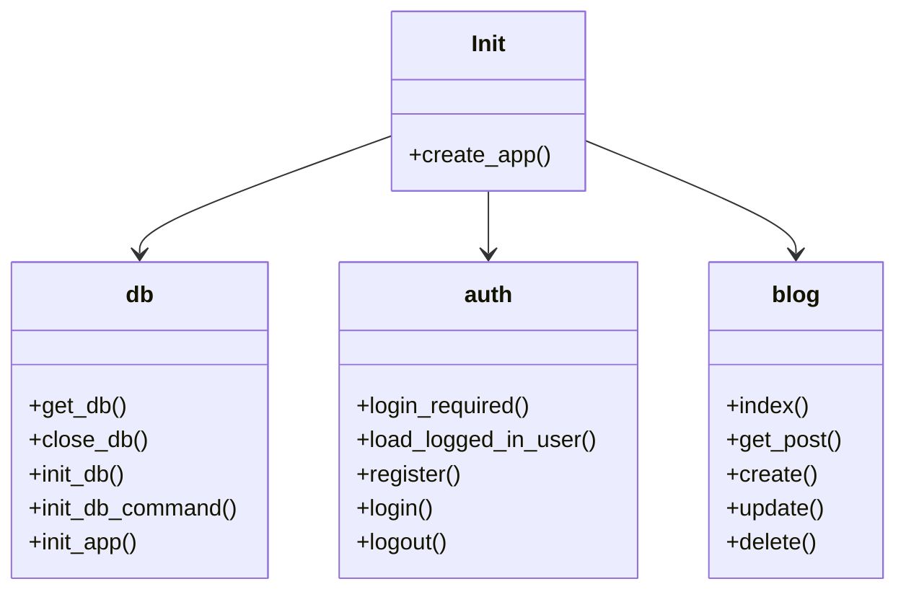

# Diagrama Components

Descriure tots els components de l'aplicacio

Components: db, _ init_ , auth, blog
## db
Descripcio: funcions d'acces a BBDD
Metodes
- get_db: conecta la aplicacion a la base de datos configurada
- close_db: si la peticion esta conectada a la base de datos que cierre esta conecion
- init_db: borra los datos existentes y crea nuevas tablas
- init_db_command: borra los datos existentes y crea nuevas tablas
- init_app: registra las funciones de la base de datos con flask

## blog
- index: muestra todos los post el mas reciente primero
- get_post: obtiene un post y la id de su autor verifica si la id existe y si el usuario actual es el autor
- create: crea un nuevo post para el usuario actual
- update: actualiza el post si el usuario actual es el autor
- delete: se asegura de que el post existe y que el usuario que se a loggeado es el author del post

## auth
- login_required: mira el decorador que redirecciona a los usuarios anonimos a la pagina de login
- load_logged_in_user: si el id del usuario esta guardado en la sesion carga el objeto del usuario de la base de datos a g.user
- register: Registra un nuevo usuario valida que el usuario no esta pillado y ponle hashes al pasword por seguridad
- login: que haga log un usuario ya registrado poniendo su id de usuario en la sesion
- logout: borrar el usuario actual incluyendo su id guardado

## _init_
- create_app: crea y configura una instancia de la aplicacion de flask

