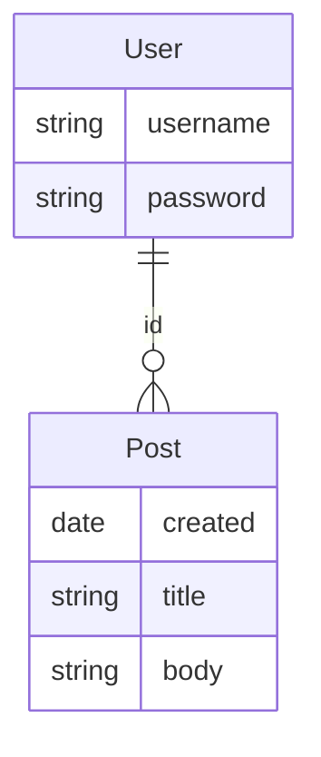

# modeldedades

# Model entitat relacio E/r

| End-Point | Method | Descripció |
| ----------- | ----------- | ----------- |
| /hello | GET |         |
| /register | GET |         |
| /register | POST |         |
| /login | GET |         |
| /login | POST |         |
| /logout | GET |         |
| / | GET |         |
| /create | GET |         |
| /create | POST |         |
| /<int:id>/update | GET |         |
| /<int:id>/update | POST |         |
| /<int:id>/delete | POST |         |